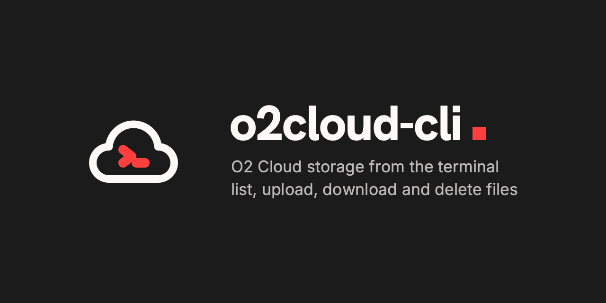

<p align="center"></p>

<p align="center">
  <a href="https://crates.io/crates/o2cloud-cli"></a>
  <a href="https://github.com/danielperez9430/o2cloud-cli/actions/workflows/release.yml"></a>
  <a href="./LICENSE"></a>
</p>

<p align="center">
  <b>Manage your O2 Cloud (Telefónica Spain) storage from the terminal.</b><br>
  <a href="README.es.md">Español</a>
</p>

---

## ✨ Features

- 🔐 **Login** with your phone number and SMS code, in the same login window the O2 Cloud website uses
- 📂 **Browse** folders as a list or a tree, and **search** by name
- ⬆️ **Upload** single files, whole folders, or a folder as a `.zip`; files over 4 GB go up in parts and are joined again on download, and interrupted uploads can be resumed
- ⬇️ **Download** by ID, path or file name
- 🔗 **Share** files and folders with a public link, and remove the link again
- 🗂️ **Create**, **move** and **rename** folders; **move**, **rename** and **copy** files (copies are made on the server, nothing is downloaded)
- 📊 See your **storage**: used, free and in the trash
- 🗑️ **Delete** to the trash, with safety checks (confirmation for folders, the root folder can't be deleted, ambiguous names are never guessed)

## 📦 Installation

With [Rust](https://rustup.rs) installed:

```bash
cargo install o2cloud-cli
```

Pre-built binaries for macOS, Linux and Windows are attached to each [GitHub release](https://github.com/danielperez9430/o2cloud-cli/releases). The Linux one needs glibc 2.39 or later (Ubuntu 24.04, Debian 13, Fedora 40 or newer); on older systems, install with `cargo install`.

<details>
<summary>🛠️ Build from source</summary>

```bash
git clone https://github.com/danielperez9430/o2cloud-cli
cd o2cloud-cli
cargo build --release
./target/release/o2cloud --help
```

</details>

### 🧰 Requirements

| Platform | Needs |
|---|---|
| macOS | Nothing extra |
| Linux | `sudo apt install libwebkit2gtk-4.1-dev libgtk-3-dev` |
| Windows | The [WebView2 runtime](https://developer.microsoft.com/microsoft-edge/webview2/) (preinstalled on Windows 11 and up-to-date Windows 10) |

You also need an O2 Cloud account (an O2 Spain mobile line).

## 🚀 Quick start

```console
$ o2cloud login
→ Opening login window (web login: the session ends after a while without use; enter your phone number there)...
✓ Login successful — tokens saved
Logged in as +34 600000000

$ o2cloud ls
📁 /

  12345679    📁 Documents/  8 files, 3.4 MB
  12345678    📁 Photos/     240 files, 610.2 MB

  1234567890     1.2 MB  notes.pdf

  2 folders, 1 file, 614.8 MB in total

$ o2cloud upload-dir ./holidays --folder 12345678
→ Uploading ./holidays (24.0 MB) — 12 files, 1 dirs...
  📁 holidays/ (created id:12345690)
  ...
✓ Uploaded 12 files to ./holidays
```

## 📖 Commands

| Command | What it does |
|---|---|
| 🔐 `login` | Log in (opens a login window) |
| ℹ️ `status` | Show the account and whether the session is still active |
| 🚪 `logout` | Remove the stored session |
| 📂 `ls [folder]` | List a folder (`-t` tree, `-a` every file, `-l` dates, `-s` sort, `-n` filter, `--folder-only`, `--no-folder`, `--json`) |
| 🔍 `find <text>` | Search files and folders by name |
| ⬆️ `upload <file>… [/folder]` | Upload files (the last argument, or `--folder`, says where: an ID or a path like `/Photos/2024`, which must exist; `--on-conflict` for a file already there with another size) |
| 📁 `upload-dir <dir>` | Upload a folder and everything in it (`-j <n>` files at a time, default 2; `--ext jpg,mp4` for only those extensions; `--update` to also replace files changed locally; `--dry-run` to only see what it would do) |
| 🗜️ `upload-zip <dir>` | Zip a folder and upload the `.zip` |
| ⬇️ `download <file>` | Download a file (`-o` to choose the local path) |
| 📥 `download-dir <folder>` | Download a folder and everything in it, or `/` for the whole account (`-o <dir>`, `-j <n>`, `--ext`, `--dry-run`) |
| 🗑️ `rm <file or folder>…` | Move to the trash (one or more; `-r` for folders, `-y` to skip confirmation) |
| 🔗 `share <file or folder>` | Create a public link and print its URL |
| 📋 `shares` | List shared folders |
| 🚫 `unshare <folder>` | Remove a folder's public link |
| 📁 `mkdir <folder>` | Create a folder (`-p` to create missing parents too) |
| 📦 `mv <file or folder> <folder>` | Move a file or folder to another folder |
| 📑 `cp <file> <folder>` | Copy a file on the server (`--name` to name the copy) |
| ✏️ `rename <file or folder> <name>` | Rename a file or folder |
| 🩹 `fix-jpeg <file or folder>` | Find JPEGs whose colour profile O2 Cloud can't read (`MED-1000`); `--apply` repairs them without touching the image |
| 📊 `quota` | Show storage used, free and in the trash |

Run `o2cloud <command> --help` for all the options.

### 🧩 JSON output

> **Upgrading from 0.x?** 1.0 changes exit codes, errors with `--json`, the login window and uploads of files already in the cloud: see [MIGRATING.md](MIGRATING.md).

`ls`, `find`, `upload`, `upload-dir`, `upload-zip`, `download`, `download-dir`, `fix-jpeg`, `mkdir`, `cp`, `share`, `shares`, `status` and `quota` take `--json` and print one JSON value to stdout, for scripts and other apps. Progress messages still go to stderr. An error is `Error: …` on stderr and, with `--json`, also a JSON value on stdout in place of the result (unless the result was already printed, as `upload-dir` and `download-dir` do before saying some files failed):

```json
{ "error": { "code": "session_expired", "message": "Session expired: …", "retryable": false, "exit_code": 4, "run": "3fa9c1d2" } }
```

**For apps: `--json-lines`.** `upload`, `upload-dir`, `upload-zip`, `download` and `download-dir` can print events as they happen instead, one JSON object per line on stdout:

```json
{"event":"start","command":"upload-dir","files":3,"bytes":40000004,"schema":1,"run":"3fa9c1d2"}
{"event":"progress","local":"big.bin","bytes":8126464,"size":20000000}
{"event":"file","local":"big.bin","action":"uploaded","ids":[1615362889],"id":1615362889,"size":20000000,"sha256":"9f2c…"}
{"event":"summary","files":3,"uploaded":3,"skipped":0,"conflicts":0,"failed":0}
```

- `start` opens the run, with `files`, `bytes` and the format's version, `schema`.
- `progress` comes at most four times a second per file, with the bytes moved so far.
- `file` is the same entry `--json` gives. It has `ids` (always a list) and, for a file uploaded whole in this run, its `sha256`, computed while it's read to be sent.
- `retry` says the server was busy, failing or still processing a file, and the request (or an upload) goes again.
- `summary` gives the counts.
- `error` closes a run that failed, as in `--json`.

Exit codes are the same as without the flag.

Exit codes: `0` done; `2` a request it won't carry out as given (bad arguments, an ambiguous name, a change O2 Cloud doesn't allow); `3` not found; `4` not logged in or session expired (`code` `not_logged_in` / `session_expired`; log in with `o2cloud login`); `5` conflict, something with that name is already there (`conflict`); `6` some files of a run failed and the rest were done (`partial_failure`; run it again: what's already there is skipped); `7` the network or O2 Cloud failed (`network`, `server_error`, `bad_response`; worth trying again later); `1` anything else. `retryable` is `true` for 6 and 7.

When the session has expired, the login window only opens by itself if you're at a terminal. A script or an app gets exit code 4 instead, and logs in with `o2cloud login` when it chooses (set `O2CLOUD_LOGIN_WINDOW=1` to open it anyway).

```console
$ o2cloud upload ./movie.mkv --json 2>/dev/null
{ "id": 1234567890, "name": "movie.mkv", "folderid": 12345678, "size": 1048576 }
$ o2cloud mkdir -p /Backups --json 2>/dev/null
{ "id": 12345679, "path": "/Backups", "created": false }
```

- `ls`: `path`, `folders` (`id`, `name`, and the `files` and `size` they hold, `null` with `--folder-only`) and `files` (`id`, `name`, `size`, `date`). `ls -a --json` is a list of files with their `path`.
- `find`: `folders` (`id`, `name`, `path`) and `files` (`id`, `name`, `size`, `date`, `path`), as in `ls --json`.
- `upload` and `upload-zip`: one object for one file, a list for several: `local` (the path given), `name`, `folderid`, `size`, `action` (`uploaded`, `skipped` if it was already there, `updated` with `replaced`, `differs`, `conflict` with `cloud` and `modified`, or `failed` with `error` for one of several), `ids` (always a list), `skipped`, and `id` (or `parts`, one ID per part, for a file uploaded in parts). If a single file fails (other than a conflict), there's no entry: stdout has the JSON error instead. Use the IDs in scripts: a new upload takes up to a minute to show up in `ls`, `find` and paths, but `rm`, `mv`, `rename`, `cp`, `share` and `download` accept its ID right away (waiting a few seconds for the server if needed).
- `upload-dir`: an array with one object per file: `local` (its path inside the directory), `name`, `folderid`, `size`, `skipped`, and `id` (or `parts`), or `error` if that file failed. An empty `.jpg`, `.jpeg`, `.png`, `.gif`, `.webp` or `.heic` isn't sent, since O2 Cloud rejects empty images: it has `"skipped": true, "empty": true` and no `id`. Each entry also has `ids` (always a list) and `action`: `uploaded`, `skipped`, `empty`, `failed`, `differs` (another size than in the cloud, left alone with `--on-conflict skip`), `conflict` (another size, not uploaded: see Files already in the cloud), `updated` (plus `replaced`, the IDs of the old version now in the trash) or, with `--update`, `older`. An `older` entry has the cloud copy's `id`, and a `differs` entry its `id`, or `parts` if it's in parts. With `--dry-run` the entries have `"dry_run": true`, no `skipped`, and `action` is what it would do: `upload`, `update` (plus `replaces`), `resume`, `unchanged`, `differs`, `conflict`, `older`, `empty`, or `failed` for a file beyond O2 Cloud's limits; `folderid` is `null` for a folder that doesn't exist yet.
- `download`: `id` (or `parts`, for a file uploaded in parts), `ids`, `name`, `path` (where it was saved, absolute), `size` and `"action": "downloaded"`.
- `download-dir`: an array with one object per file: `id` (or `parts`), `name`, `cloud` (its path in the cloud), `local` (its path inside the output folder, with `/`), `path` (where it was saved), `folderid`, `size`, `action` (`downloaded`, `skipped` or `failed`), `error` if it failed, and `renamed: true` if its local name differs from the cloud one. `path` is relative if `-o` was. With `--dry-run`, the entries have `"dry_run": true` and `action` is what it would do with what's on disk: `download`, `resume` (a cut download it would carry on), `skipped` (already there) or `failed` (a local file of that name it won't overwrite).
- `fix-jpeg`: an array with one object per JPEG with a problem: `path`, `problem` (`mislabelled` or `damaged`), `chunks`, `fixed`, and `error` if repairing it failed.
- `mkdir`: `id`, `path`, and `created` (`false` when `-p` found it already there).
- `cp`: `id` of the copy, `name`, `folderid`, `path`, and `source` (the original's ID); for a file in parts, `parts` and `source_parts` instead of `id` and `source`.
- `share`: `id` and `url` of the link, `path`, and `folder` (`true` for a folder; its `id` is what `unshare` takes).
- `shares`: an array of links: `id`, `url`, `uses`, `folderid`, `path` and `foldername`.
- `quota`: `quota`, `used`, `free`, `softdeleted` (in the trash), in bytes, and `nolimit`.
- `status`: `logged_in`, `phone`, `since`, `session` (`active`, `expired` or `unknown`), `renews_silently`, `login` (`app` for the login that renews without SMS, `web` otherwise), and `storage` (as in `quota`, or `null`).

### 🎯 Naming files and folders

Wherever a command takes a file or folder, you can use any of these:

| Form | Example | Meaning |
|---|---|---|
| ID | `1234567890` | As shown by `ls` and `find` |
| Path | `/Documents/notes.pdf` | Starts with `/`: an exact path from the root |
| Name | `notes.pdf` | No `/`: searched in the whole account; must be unique |

If a name matches several files, nothing happens and the CLI lists the matches so you can pick one:

```console
$ o2cloud download notes.pdf
Error: 'notes.pdf' is ambiguous — 2 files have that name:
  1234567890    /notes.pdf
  1234567891    /Documents/notes.pdf
Use the ID or the full path.
```

## 💡 Examples

<details open>
<summary><b>📂 Browse and search</b></summary>

```bash
o2cloud ls                     # root folder
o2cloud ls /Photos/2024        # a folder by path
o2cloud ls 12345678            # a folder by ID
o2cloud ls -t                  # tree view
o2cloud ls -a                  # every file, flat
o2cloud ls -a /Photos          # every file under /Photos
o2cloud ls -l -s date -r       # with dates, newest first
o2cloud ls -s size -r --limit 10   # the 10 biggest files
o2cloud ls -n '*.heic'         # only names matching a pattern
o2cloud ls --json | jq '.files[].id'   # JSON for scripts
o2cloud ls /Photos --folder-only      # fast on a large account (no subfolder totals)
o2cloud ls --no-folder                # only the photos and videos the phone app uploaded
o2cloud find invoice           # case-insensitive search
```

</details>

<details open>
<summary><b>🔄 Upload and download</b></summary>

```bash
o2cloud upload ./report.pdf                      # to the root folder
o2cloud upload ./report.pdf --folder 12345679    # to a folder (by ID)
o2cloud upload-dir ./holidays                    # creates holidays/ and uploads into it
o2cloud upload-zip ./project                     # uploads project.zip
o2cloud upload-dir ./holidays                    # again: skips what's already there
o2cloud upload-dir ./holidays --ext jpg,mp4      # only these extensions
o2cloud upload-dir ./holidays --update --dry-run # what changed since the last upload
o2cloud upload-dir ./holidays --update           # upload new and changed files
o2cloud upload ./disk.iso                        # over 4 GB: disk.iso.001, disk.iso.002, …

o2cloud download /Documents/report.pdf           # saved as ./report.pdf
o2cloud download 1234567890 -o ~/Desktop/copy.pdf
o2cloud download /disk.iso                       # joins disk.iso.001, .002, … into disk.iso
o2cloud download-dir /Photos -o ~/backup         # ~/backup/Photos with every subfolder
o2cloud download-dir / -o ~/o2-account           # the whole account (e.g. before leaving)
o2cloud download-dir / -o ~/o2-account                   # again: resumes after a cut
```

</details>

<details open>
<summary><b>🔗 Share</b></summary>

```console
$ o2cloud share /Photos/2024
✓ Public link created for /Photos/2024/ — anyone with it can access it:
https://cloud.o2online.es/share/f/EXAMPLE-TOKEN
  (link 100001; remove it with `o2cloud unshare 100001`)

$ o2cloud shares
LINK ID     USES  URL                                            FOLDER
100001         3  https://cloud.o2online.es/share/f/EXAMPLE-TOKEN  /Photos/2024/

$ o2cloud unshare /Photos/2024
✓ /Photos/2024/ is no longer shared
```

The URL is printed alone on standard output, so scripts can capture it: `url=$(o2cloud share /notes.pdf)`.

</details>

<details open>
<summary><b>🗂️ Organize and delete</b></summary>

```bash
o2cloud mkdir /Photos/2024              # create a folder
o2cloud mkdir -p /Photos/2024/Summer    # creating missing parents too
o2cloud mv /notes.pdf /Documents        # move a file...
o2cloud mv /Photos/2024 /Archive        # ...or a whole folder
o2cloud rename /Documents/notes.pdf notes-2024.pdf
o2cloud rename /Archive/2024 Photos-2024
o2cloud cp /Documents/notes.pdf /Backup                  # copy, on the server
o2cloud cp /Documents/notes.pdf /Backup --name old.pdf   # with another name

o2cloud rm /Documents/notes-2024.pdf    # a file
o2cloud rm /Photos/old -r               # a folder and its contents (asks first)
o2cloud rm /Photos/old -r -y            # same, without asking (for scripts)
```

</details>

## ⚠️ Good to know

> [!NOTE]
> **A session ends when it goes unused for a while** (in our tests it was gone after two hours without use; one in constant use, by a long `upload-dir`, lasted over 14 hours), and it isn't renewed automatically. So expect the login window again after a break. When one expires, the next command you run at a terminal opens the login window again (without a terminal, as in a script or an app, it stops with exit code 4: run `o2cloud login`; without a window at all, log in with [browser cookies](#️-logging-in-without-a-login-window)). `o2cloud status` tells you whether yours is still active. If it expires in the middle of a command, the command stops with "Session expired"; a long `upload-dir` stops instead of failing every remaining file, and running it again logs in and carries on where it stopped. The advanced **Staying logged in without SMS** mode below renews itself.

> [!WARNING]
> **Shared links are public**: anyone with the URL can open the file or folder. Sharing the root folder is refused, since it would publish the whole account.

- **Deletes go to the trash**, so they can be restored from the O2 Cloud website.
- **`download-dir`** recreates the folder inside `-o` (the whole account, `/`, goes straight into it, phone-app photos included), with empty subfolders, and joins the files this CLI uploaded in parts (someone's own `x.001`, `x.002`… volumes, uploaded as files, come down as they are). Each file is written to a hidden `.<id>.o2part` next to it and renamed when complete, with the date it had when it was uploaded; files already there with the same size are skipped, and a cut download is resumed from where it stopped; `--dry-run` says what it would download, resume, skip or leave alone, without a request per file. Names your system can't use are adjusted (on Windows `<>:"|?*`, trailing dots, `CON`…), and two names that differ only in case get the file's ID added, so nothing is lost on a case-insensitive disk; `--json` marks those `renamed`.
- **`download` never overwrites** an existing local file. Without `-o`, it only uses the file's name, never a directory sent by the server. It writes the file in place with a hidden `.<name>.o2dl` next to it while it's incomplete: if it's cut, the same command resumes it from where it stopped (by the part it stopped in, for a file in parts). The finished file gets the date it had when it was uploaded.
- **`upload-dir` skips hidden files and folders** (`.git`, `.DS_Store`…), because O2 Cloud rejects them, and the files the OS keeps for itself (`Thumbs.db`, `desktop.ini`, `$RECYCLE.BIN`…). `upload-zip` includes them inside the zip.
- **Files over 4 GB** (the most O2 Cloud takes in one upload) go up in parts named `name.001`, `name.002`, … `download name` joins them, and so does `cat name.0* > name` (or 7-Zip) after downloading the parts some other way. `download` refuses to join them if a part is missing or doesn't belong with the others. `rm`, `mv`, `rename`, `cp` and `share` also take the file by its own name and act on all its parts; naming one of its parts on its own (`name.002`) is refused, since it would break the file (its ID still works). Uploading a file in parts where parts of one with the same name already are resumes it if they match it, and is otherwise a conflict.
- **`upload-dir --update`** also uploads files that changed locally: another size, or a modification date more than 2 seconds newer than the one the cloud's copy was uploaded with. It uploads the new version first and only when that worked moves the old one to the trash and gives the new one its name (O2 Cloud would otherwise call it `name (1)`), so a failed upload leaves the old version alone. A file older locally than in the cloud is left alone, even if its size differs: `--update` never puts an older version over a newer one. A file that grew past the 4 GB part size (or shrank below it) replaces its old parts (or whole file). Files are compared by name, size and date, not contents. `--dry-run` shows what it would upload or update without changing anything: worth running first on a large folder.
- **Files already there:** `upload`, `upload-dir` and `upload-zip` skip a file (or part) the target folder already has with the same name and size (the contents aren't compared), so running them again carries on where they stopped. A file there with the same name but another size (whole, or in parts, also when it crossed the 4 GB part size) is a conflict, settled by `--on-conflict`:
  - `ask` (the default at a terminal): shows both copies' size and date and asks: overwrite, skip, overwrite all, skip all, or quit. `upload-dir` asks everything before uploading anything, so the run then goes on by itself.
  - `fail` (the default otherwise, e.g. in a script, an app, or with the messages sent to a file): doesn't upload it and ends with exit code 5; with `--json` the entry has `"action": "conflict"`, the local `size` and `modified`, and `cloud` with the cloud copy's `id` (or `parts`), `size` and `modified`, so an app can ask its user and run it again with `overwrite` or `skip`.
  - `skip` (or `--skip-existing`): leaves the cloud's copy alone (`"action": "differs"`).
  - `overwrite`: uploads the new version, and once that worked moves the old one to the trash and gives the new one its name (`"action": "updated"`, with `replaced`).
  - `duplicate`: uploads everything anyway, as before 1.0: O2 Cloud keeps both, naming the new one `name (1)`, and files already there are uploaded again.

  `overwrite` and `upload-dir --update` also replace a file of the same size that is newer locally (a container or database that changed in place); with `--update` the other policies don't apply, and an older version is never put over a newer one. A `name.001` that is itself a local file next to `name` is never taken for a part of it. New uploads take up to a minute to show up in listings; `upload`, `upload-zip` and `upload-dir` remember what this computer uploaded and wait (up to 2 minutes) for it to be listed before deciding, so running it again right away, for example after the session expired, doesn't upload those files twice. Files uploaded from elsewhere moments ago may still not be seen.
- **O2 Cloud checks what it stores:** files that are empty or damaged, or whose content doesn't match their extension (a HEIC photo named `.jpg`), are rejected with `MED-1050` or `MED-1000`, every time, so retrying won't help. `upload-dir` doesn't send empty `.jpg`, `.jpeg`, `.png`, `.gif`, `.webp` or `.heic` files at all (it lists them as skipped); other empty files are uploaded.
- **JPEGs rejected with `MED-1000`:** some software splits a large colour profile into chunks all labelled "1 of 1"; viewers cope, O2 Cloud doesn't. `o2cloud fix-jpeg ./photos` lists them and `--apply` relabels the chunks in place (about 12 bytes; the image and the file's date are kept). When an upload fails this way, the error says so.
- **O2 Cloud's limits:** a file name can be up to 255 bytes in UTF-8 (255 plain letters, but only 129 `ñ` or 87 `日`), a folder name up to 255 characters, and folders can go 20 levels below the root. There is no limit on the whole path, since O2 Cloud stores names, not paths. `upload-dir` leaves out (and reports) what doesn't fit instead of stopping halfway, and `mkdir`, `rename` and `upload` say which limit was hit.
- **Long paths on Windows:** local paths over 260 characters work without turning on `LongPathsEnabled`.
- **Symlinks:** links to files are followed; links to folders are skipped with a warning, so a link back to a parent folder can't cause an endless loop.
- **Nothing is overwritten:** `mkdir`, `mv`, `cp` and `rename` refuse to create a second file or folder with the same name in the same place.
- **Not supported yet:** unsharing a file, and copying folders. Use the website for those for now.

## 🐞 Reporting a problem

If something goes wrong, run

```sh
o2cloud debug-report
```

and attach the `o2cloud-report-….zip` it writes to an [issue](https://github.com/danielperez9430/o2cloud-cli/issues). It has the version, your system, your settings (never the session keys) and the logs of the last 3 runs, with every file and folder name replaced by a stand-in that keeps what name bugs need (extension, length, accents, trailing dots). Nothing is sent anywhere; look it over before attaching it. `--stdout` prints it instead, and `--include-names` keeps the names.

Every error ends with the run's ID (`… [run 3fa9c1d2]`), which finds its log. Each run keeps a small log in the cache folder (`~/Library/Caches/o2cli/logs` on macOS, `~/.cache/o2cli/logs` on Linux, `%LOCALAPPDATA%\o2cli\logs` on Windows): the last 10 runs of commands that change or transfer something (`ls`, `find`, `status` and the like keep none), at most 5 MB each (50 MB with `--debug`; past that, only warnings and errors), removed by `o2cloud logout`. `O2CLOUD_LOG_FILE=0` turns it off.

Long transfers show a progress bar (files, bytes, speed, time left); `-v` adds a line for each file, and `-q` shows only warnings and errors. To see what a command does step by step (each request, retries, and why each file is uploaded, skipped or left alone), add `--debug`: it shows it on stderr and keeps it in the run log in full. `O2CLOUD_LOG=debug` does the same for apps and scripts, and `O2CLOUD_TRACE=1` shows only the requests. Session keys, tokens and signed download links never appear, on screen or in the logs; nor does your phone number in logs, reports or error messages (`status` and `login` show it, as they're meant to).

## 🖥️ Logging in without a login window

Normally `o2cloud login` opens a small window for your phone number and SMS code. On a headless machine, or a Linux desktop where that window can't open (for example some Wayland setups), log in with the session cookies of a browser instead:

1. Log in at [cloud.o2online.es](https://cloud.o2online.es) in any browser.
2. Open the developer tools (F12) → **Application** (Chrome/Edge) or **Storage** (Firefox) → **Cookies** → `https://cloud.o2online.es`.
3. Copy the values of the `JSESSIONID` and `validationKey` cookies (the browser shows the second one as `validationKey`, with a capital K), and pass them to `login`:

```bash
o2cloud login --jsessionid "<JSESSIONID>" --validationkey "<validationkey>"
```

To keep them out of your shell history, pass them as environment variables instead:

```bash
export O2CLOUD_JSESSIONID="<JSESSIONID>" O2CLOUD_VALIDATIONKEY="<validationkey>"
o2cloud login
```

The cookies are checked against O2 Cloud before they are saved. Treat them like a password — anyone who has them can reach your account until the session expires. Like any session, this one ends when it goes unused for a while; after that, copy fresh cookies and log in again.

## 🧪 Advanced: staying logged in without SMS

> [!WARNING]
> **Advanced, use at your own risk.** This logs in through the **mobile app's** OAuth flow instead of the web one. It needs the app's OAuth **client id and client secret** — the CLI does **not** ship them, you supply them — and makes the CLI identify to Telefónica as the official app. It relies on an undocumented flow that may stop working if Telefónica changes it or rotates the credentials. The default `login` above is the supported one.

The upside: this login stores a refresh token, so the session **renews itself without a new SMS code** (for about 60 days). That makes scheduled and unattended jobs practical.

```bash
export O2CLOUD_OAUTH_CLIENT_ID="<client-id>"
export O2CLOUD_OAUTH_CLIENT_SECRET="<client-secret>"
o2cloud login
```

You still enter your phone number and SMS code once in the login window. After that, when the session expires the next command renews it silently:

```console
$ o2cloud ls
→ Session expired, trying silent re-login...
✓ Session refreshed silently
📁 /
...
```

The client id and secret are stored with the session in `auth.json` (readable only by you; `logout` deletes them), so if a renewal ever fails, the login window that opens uses this same login again and the session keeps renewing itself. `o2cloud login` does too, until you `logout`. `o2cloud status` shows whether your session renews on its own. Keep the client secret out of the repository and your shell history: prefer the environment variables over the `--oauth-client-id` / `--oauth-client-secret` flags, and never commit it.

## ⚙️ How it works

O2 Cloud runs on **Synchronoss OneMediaHub**. `o2cloud` talks to the same API as the O2 Cloud website, and by default logs in the same way: Telefónica's OAuth2 / OpenID Connect login, with PKCE handled by the O2 Cloud server, so the default login needs no client secret. You type your phone number and SMS code in the login window, never in the terminal. (The optional **Staying logged in without SMS** mode above instead uses the mobile app's OAuth client, which you supply, to keep the session alive without SMS.)

The session is stored in `auth.json`, and a cache of the account's file list (names, sizes, dates and folders; see below) in `media-cache.json`:

| OS | Session | File list cache |
|---|---|---|
| macOS | `~/Library/Application Support/o2cli/auth.json` | `~/Library/Caches/o2cli/media-cache.json` |
| Linux | `~/.config/o2cli/auth.json` | `~/.cache/o2cli/media-cache.json` |
| Windows | `%APPDATA%\o2cli\auth.json` | `%LOCALAPPDATA%\o2cli\media-cache.json` |

On macOS and Linux both files are readable only by your user (`0600`). `o2cloud logout` deletes them.

**Speed on large accounts:** listing every file takes one request per 1,000 files, so commands avoid it where they can. A file or folder given by ID or path (`/docs/a.txt`) is looked up on its own, and only a bare file name (`a.txt`), `ls`, `upload-dir` and `rm` of a folder list the whole account. `ls --folder-only` lists just the folder, without its subfolders' totals; in the root it leaves out the photos and videos the phone app uploaded, which have no folder (`ls --no-folder` lists those). Those keep the file list in the cache above and, after the first time, only ask the server what changed since (two requests in all for a `ls`); the whole account is listed again once a week, or whenever the cache can't be brought up to date. Set `O2CLOUD_CACHE=0` to always list everything and not touch the cache. Requests that only read (listings, the change log) are tried again for about 30 s on a server error, since O2 Cloud has short outages. Set `O2CLOUD_TRACE=1` to see each request a command sends (method, path, status and time; never the session keys) and how many there were.

## 📄 License

[MIT](./LICENSE)
